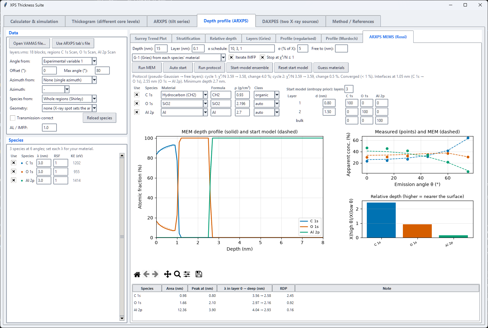
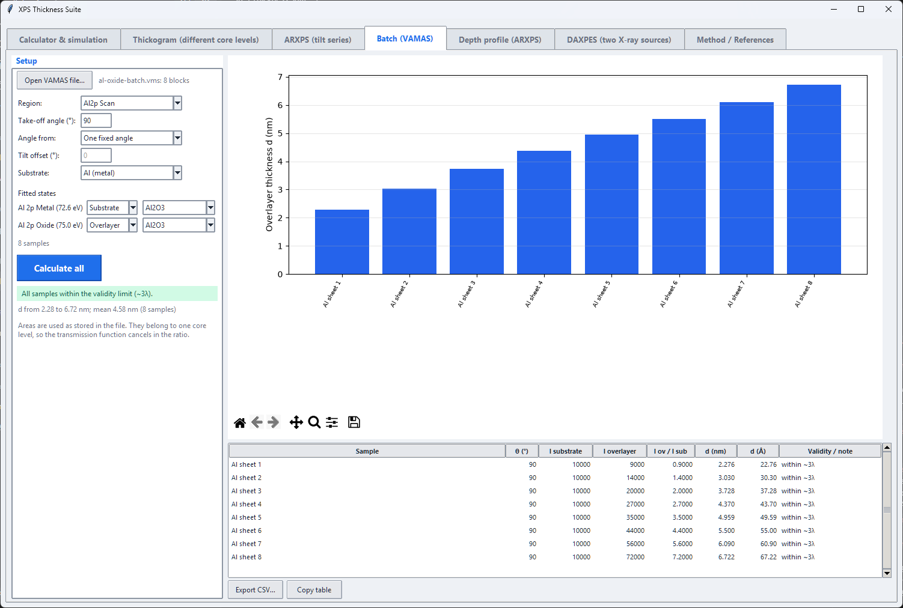
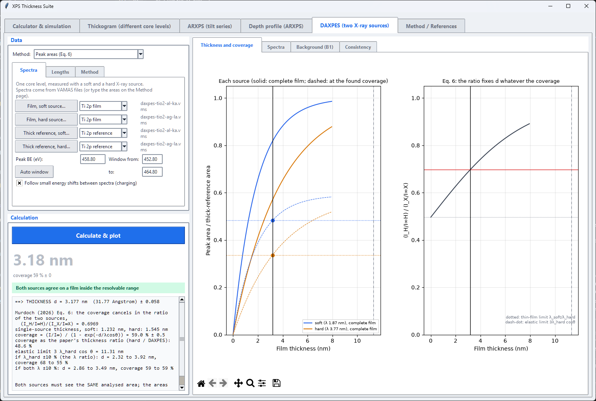

# XPS Thickness Suite

Desktop tools for estimating the thickness of thin overlayers (oxides, hydroxides, nitrides, passivation layers,
contamination films) from XPS peak areas. One window, one tab per method, with a simulated spectrum, the classic
Thickogram nomogram, Topofactor corrections for fibres and particles, and angle-resolved analysis of VAMAS tilt series.


## The tools

| Tab | Method | Use it when |
|---|---|---|
| **Calculator and simulation** | Strohmeier equation | The overlayer and substrate are two chemical states of the **same core level** (metal and oxide components of Al 2p, Cu LMM, Si 2p ...). Uses densities and IMFPs and draws a simulated spectrum. |
| **Thickogram** | Cumpson's Thickogram, with optional Topofactor | The overlayer and substrate are **different peaks** (a Fe 2p overlayer on Si 2p). Uses RSFs and kinetic-energy scaling and draws the nomogram. The Topofactor corrects for **fibres and particles**. |
| **ARXPS (tilt series)** | Ratio against 1/cos(theta) from a VAMAS tilt series | You measured the **same spot at several emission angles**. Reads VAMAS files and takes the substrate and overlayer areas either from windows with a Shirley background or from a **peak fit saved by CasaXPS**; fits the thickness from the slope and plots it against azimuth if the file has one. |
| **Batch (VAMAS)** | Strohmeier for every sample of a CasaXPS-fitted file | You have **one core level fitted as substrate + overlayer in many samples** (e.g. Al 2p metal + oxide) and want a thickness per sample. Loads the VAMAS file, takes the fitted state areas as stored, and tabulates, plots and exports (CSV) the thickness of each sample. |
| **Depth profile (ARXPS)** | Surrey Trend Plot, Stratification, relative depth plot, Layers (Gries), the ARXPS MEMS (Rossi) maximum-entropy profile and regularised (Tikhonov or the ARCtick 3-point method) and Murdoch (Tikhonov, apparent concentrations) depth profiles | You want to see how **several species** change with emission angle and which ones sit together in depth. |
| **DAXPES (two X-ray sources)** | Murdoch's dual-anode method, by peak areas or by the Tougaard background (B1) | You measured **one core level with a soft and a hard X-ray source** (Al Kα and Ag Lα or Ga Kα) and the film may cover only **part of the analysed area**: gives the thickness, which does not depend on the coverage, and the coverage. |
| **Method / References** | | The full documentation, with typeset equations, inside the app. |








## Quick start

The calculation itself needs only Python 3 with Tkinter (included in the standard Windows installer). The simulated
spectrum, the Thickogram tab and the typeset help need numpy and matplotlib:

```
pip install numpy matplotlib
python app.py
```

## The maths in brief

For two states of one core level the thickness is [1]

```math
d = \lambda_{ox}\,\sin\theta\;\ln\left[\frac{N_m\,\lambda_m\,I_{ox}}{N_{ox}\,\lambda_{ox}\,I_m}+1\right]
```

For two different peaks, with $x = t/(L\,\cos\theta)$, $B = (E_o/E_s)^{0.75}$ and $A = I_o/(I_s R_o)$, the Thickogram [3] solves

```math
A = (1-e^{-x})\,e^{B x}, \qquad t = x\,L\,\cos\theta
```

and for a fibre or particle the true thickness is the Thickogram thickness times a Topofactor [4]

```math
T = \mathrm{TF}\cdot t, \qquad \mathrm{TF} \approx c_0 + \left(c_1 + c_2\ln B\right)t^{k} + c_3\,e^{-c_4 B}
```

with shape-dependent constants from Shard, Wang and Spencer (0.79 for a long fibre and 0.67 for a sphere are good
averages). Topofactors apply to objects much larger than the electron attenuation length, not to nanoparticles.

For a tilt series the reduced thickness $x_i = d/(\lambda\cos\theta_i)$ found at each angle lies on a straight line
through the origin when plotted against $1/\cos\theta$, and the slope gives the thickness [12]

```math
x_i = k\,u_i,\qquad u_i = \frac{1}{\cos\theta_i},\qquad d = k\,\lambda
```

## Documentation

- [User guide](docs/user-guide.md): how to use each tab, with worked examples.
- [Methods](docs/methods.md): the equations, assumptions and limits behind every number.
- [Presets and data](docs/presets.md): every reference value, with its source (generated from the code).
- [References](docs/references.md): the papers, with DOIs.

The same pages are shown, with typeset equations, in the app's **Method / References** tab.

## Tests

```
python -m unittest discover -s tests -v
```

The tests pin the presets to published numbers, check the Thickogram solver against the original script, the
Topofactor against the paper's Eq. 6 and Table 1, and the documentation against the code (every equation must
typeset, every link and image must resolve, every worked-example number is recomputed). Tests that need numpy or a
display skip themselves when they are not available.

## Files

- `app.py`: the window, the Calculator tab, the presets and the Strohmeier calculation.
- `thickogram.py`, `thickogram_tab.py`: Cumpson's Thickogram (maths, nomogram, tab).
- `topofactor.py`: the Topofactor correction.
- `arxps.py`, `arxps_tab.py`: angle-resolved analysis (alignment, Shirley background, areas, fits; the tab).
- `depthprofile.py`, `depthlayers.py`, `depthreg.py`, `depthmurdoch.py`, `depthmem.py`, `depth_tab.py`: species from a tilt series, the Surrey Trend Plot, Stratification, the Gries layer model and regularised, Murdoch and maximum-entropy (MEMS) profiles (the Depth profile tab).
- `daxpes.py`, `daxpes_tab.py`, `tougaard.py`: dual-anode XPS thickness and coverage by peak areas or the Tougaard background (the DAXPES tab).
- `casa.py`: reader for CasaXPS peak fits stored in VAMAS comments (ported from eXPoSe SpectraDeck).
- `vamas.py`: VAMAS reader and writer. `synthetic.py`: synthetic tilt series for tests and the sample file.
- `spectrum_sim.py`: simulated spectra (numpy only).
- `help_viewer.py`, `gui_common.py`: the in-app documentation viewer and shared GUI styling.
- `docs/`: the documentation sources and the scripts that regenerate its figures, screenshots and preset tables.
- `docs/sample/`: synthetic VAMAS tilt series (with and without a stored CasaXPS fit) to try the ARXPS tab on.
- `legacy/thickogram_v1_3.py`: the original standalone Thickogram script, unmodified, for provenance.
- `tests/`, `NOTICE`.

## Credits

- B. R. Strohmeier, *Surf. Interface Anal.* **15**, 51 (1990), and HarwellXPS Technical Note #1: the Strohmeier equation.
- P. J. Cumpson, *Surf. Interface Anal.* **29**, 403 (2000): the Thickogram. The nomogram code derives from the
  GlowScript program by Prof. Jong Wan Lee (Hallym University); see `NOTICE`.
- A. G. Shard, J. Wang and S. J. Spencer, XPS topofactors: determining overlayer thickness on particles and fibres,
  *Surf. Interface Anal.* **41**, 541 (2009), DOI [10.1002/sia.3044](https://doi.org/10.1002/sia.3044): the Topofactor
  correction.
- M. C. Biesinger, *Surf. Interface Anal.* **49**, 1325 (2017), and T. A. Carlson and G. E. McGuire, *J. Electron
  Spectrosc. Relat. Phenom.* **1**, 161 (1972/73): preset data.
- P. J. Cumpson, *J. Electron Spectrosc. Relat. Phenom.* **73**, 25 (1995), and ISO 14701: angle-resolved XPS. D. A.
  Shirley, *Phys. Rev. B* **5**, 4709 (1972): the Shirley background. W. A. Dench, L. B. Hazell and M. P. Seah,
  *Surf. Interface Anal.* **13**, 63 (1988): the VAMAS format.
- S. Tanuma, C. J. Powell and D. R. Penn, *Surf. Interface Anal.* **21**, 165 (1994): the TPP-2M IMFP equation.

The full list is in [docs/references.md](docs/references.md).
