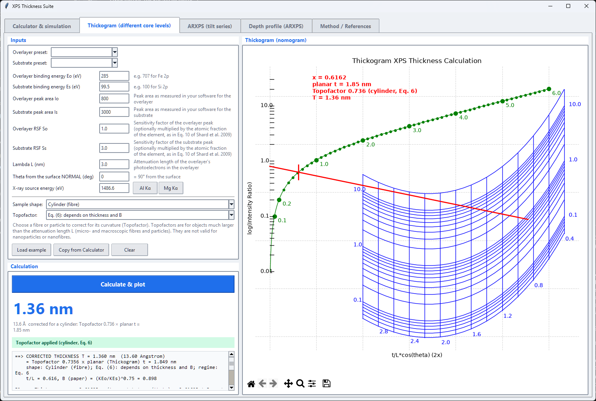
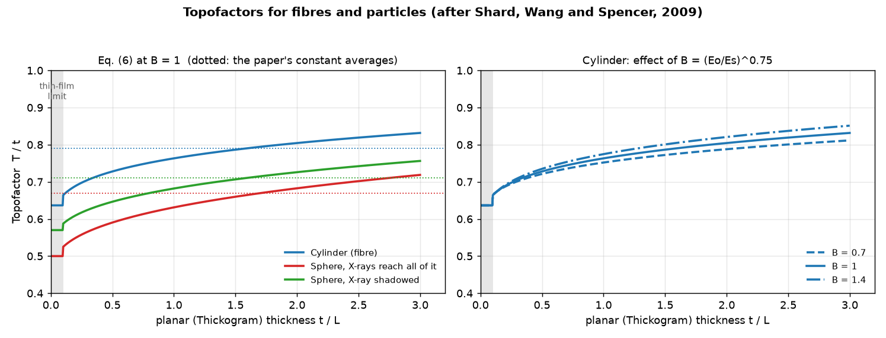

# Methods

This page gives the equations behind each tab, the assumptions they rest on, and where they come from. Numbers in
square brackets, such as [3], refer to the [reference list](references.md#references).

Contents: [Overview](#overview), [Strohmeier equation](#strohmeier-equation-calculator-tab),
[Thickogram](#thickogram-thickogram-tab), [Topofactors](#topofactors-fibres-and-particles),
[Angle-resolved XPS](#angle-resolved-xps-arxps-tab), [Depth profiles](#depth-profiles-depth-profile-tab),
[Spectrum simulation](#spectrum-simulation),
[IMFPs from TPP-2M](#imfps-from-tpp-2m).

## Overview

All the methods assume a **uniform overlayer of constant thickness on a semi-infinite substrate**, with the
overlayer and substrate signals separable by peak fitting. They differ in which signals are compared.

| Method | Signals compared | Needs | Valid for |
|---|---|---|---|
| Strohmeier (Calculator tab) | Two chemical states of the same core level, for example metallic Al and Al oxide in Al 2p | Densities, IMFPs | Flat samples, thickness up to about 3 IMFPs |
| Thickogram (Thickogram tab) | Two different peaks, for example Fe 2p overlayer and Si 2p substrate | RSFs, kinetic energies, attenuation length | Flat samples |
| Topofactor (Thickogram tab) | Correction applied to the Thickogram result | Sample shape | Fibres and particles much larger than the attenuation length |
| Depth profile (Depth profile tab) | Several species followed against emission angle | Attenuation lengths, a tilt series | Flat samples, angles up to about 70 degrees |
| ARXPS (ARXPS tab) | The same signals as above, measured at several emission angles from a VAMAS tilt series | Presets or RSFs, lambda, a tilt series | Flat samples, emission angles up to about 70 degrees |

## Strohmeier equation (Calculator tab)

For an oxide (or hydroxide, or nitride) on its own metal, the metal and oxide components of one core level are
measured in a single spectrum. With $I_m$ and $I_{ox}$ their fitted peak areas, the thickness $d$ follows from [1]:

```math
d = \lambda_{ox}\,\sin\theta\;\ln\left[\frac{N_m\,\lambda_m\,I_{ox}}{N_{ox}\,\lambda_{ox}\,I_m}+1\right]
```

Here $\lambda_m$ and $\lambda_{ox}$ are the inelastic mean free paths (IMFPs) of the photoelectrons in the metal and
in the oxide, $N_m$ and $N_{ox}$ are the volume densities of the *metal atoms* in each phase, and $\theta$ is the
take-off angle measured **from the sample surface** (90 degrees is normal emission). The equation is the solved
form of the intensity ratio for a uniform overlayer:

```math
\frac{I_m}{I_{ox}} = \frac{N_m\,\lambda_m}{N_{ox}\,\lambda_{ox}}\;\frac{\exp\left[-d/(\lambda_{ox}\sin\theta)\right]}{1-\exp\left[-d/(\lambda_{ox}\sin\theta)\right]}
```

### Volume density

The volume density of metal atoms in a compound is

```math
N = \frac{n\,\rho}{M}
```

with $\rho$ the density, $M$ the molar mass and $n$ the number of metal atoms per formula unit (2 for Cu2O and
Al2O3, 3 for Si3N4). Only the ratio $N_m/N_{ox}$ enters the equation, so the units cancel.

### Mixed overlayers

When several overlayer components are present, for example oxide and hydroxide, their areas are summed and the
overlayer density and IMFP are replaced by intensity-weighted averages [2]:

```math
N_{ave}=\frac{\sum_i N_i I_i}{\sum_i I_i},\qquad
\lambda_{ave}=\frac{\sum_i \lambda_i I_i}{\sum_i I_i}
```

```math
d = \lambda_{ave}\,\sin\theta\;\ln\left[\frac{N_m\,\lambda_m\,\sum_i I_i}{N_{ave}\,\lambda_{ave}\,I_m}+1\right]
```

### Sensitivity factors

The Calculator also accepts a relative sensitivity factor (RSF) for the substrate and each overlayer row. For the
usual same-core-level case the RSFs are identical and cancel, so they default to 1. If you combine intensities
from different core levels, the general form is

```math
d = \lambda_{ov}\,\sin\theta\;\ln\left[\frac{R_{sub}\,N_{sub}\,\lambda_{sub}\,I_{ov}}{R_{ov}\,N_{ov}\,\lambda_{ov}\,I_{sub}}+1\right]
```

For different peaks the [Thickogram](#thickogram-thickogram-tab) is the better-founded method.

### Validity

- The method assumes a uniform, continuous overlayer of constant composition.
- It is reliable up to roughly three IMFPs of the overlayer, $d \lesssim 3\lambda$, which is also about the
  sampling depth of XPS. Beyond that the metal signal vanishes into the noise. The app flags results above this
  limit.
- Elastic scattering is neglected, and the IMFP is used in place of the (slightly shorter) attenuation length.
- Strohmeier's own estimate of the accuracy is 10 to 20 percent in absolute terms, with a precision of about
  2 angstrom for repeated measurements [1].

## Thickogram (Thickogram tab)

Cumpson's Thickogram [3] gives the thickness of an overlayer from one peak of the overlayer and one peak of the
substrate, which need not be the same core level or even the same element. It also assumes a flat sample.

Let $x = t/(L\,\cos\theta)$ be the thickness in units of the overlayer attenuation length $L$ along the emission
direction; here $\theta$ is measured **from the surface normal**, so $\theta = 0$ is normal emission. The ratio of
the normalised signals is

```math
\frac{I_o/I_o^{\infty}}{I_s/I_s^{\infty}} = \frac{1-e^{-x}}{e^{-B x}}
```

where $I_o^{\infty}$ and $I_s^{\infty}$ are the intensities from infinitely thick samples of pure overlayer and pure
substrate. Substrate electrons are attenuated in the overlayer with a length $L/B$, and Cumpson takes the energy
dependence of the attenuation length as

```math
B = \left(\frac{E_o}{E_s}\right)^{0.75}
```

where $E_o$ and $E_s$ are the kinetic energies of the overlayer and substrate photoelectrons, each equal to the
X-ray energy minus the binding energy. Defining the measured ratio

```math
A = \frac{I_o}{I_s\,R_o},\qquad R_o = \frac{I_o^{\infty}}{I_s^{\infty}} = \frac{X_o S_o}{X_s S_s}
```

where $S$ is the sensitivity factor of the peak and $X$ the atomic fraction of the element in the pure material
(Eq. 10 of [4]), the equation becomes

```math
A = (1-e^{-x})\,e^{B x} = 2\,\exp\left[\left(B-\frac{1}{2}\right)x\right]\sinh\frac{x}{2}
```

and the thickness is

```math
t = x\,L\,\cos\theta
```

The equation has exactly one root $x$ for any positive $A$ and $B$, found numerically. The thickogram nomogram on
the tab is the graphical solution: draw a line from $A$ on the left scale to $B$ on the right-hand scales, and
read the answer where it crosses the green curve.

### Practical notes

- The tab asks for $S_o$ and $S_s$ as typed values, so you can enter the sensitivity factors already multiplied by
  the atomic fractions $X_o$ and $X_s$ to follow Eq. 10 of [4] exactly.
- For equal kinetic energies $B = 1$ and the equation reduces to $x = \ln(1+A)$. This is exactly the Strohmeier
  equation with $N_m = N_{ox}$ and $\lambda_m = \lambda_{ox}$, and the test suite checks it.
- The nomogram scales cover $0.4 \leq E_o/E_s \leq 3$ and $0.1 \leq x \leq 6$. Outside that range the thickness is
  still calculated but the red line leaves the printed scales.
- **Angle conventions differ between the tabs.** The Thickogram uses $\theta$ from the surface normal and the
  Calculator uses $\theta$ from the surface, so that $\theta_{surface} = 90^{\circ} - \theta_{normal}$. The
  Thickogram tab shows the conversion and its Copy from Calculator button applies it.
- The red construction line in the original Thickogram script ended at the thickness position instead of on the
  $B$ scale. The suite corrects this, so the line now meets the green curve exactly at the answer.



## Topofactors: fibres and particles

The Thickogram treats the sample as flat. For a fibre or a particle analysed with its mean surface normal pointing
at the analyser, the planar equation overestimates the overlayer thickness, because much of the surface is steeply
inclined and its overlayer is viewed along a longer path. Shard, Wang and Spencer [4] introduced the **Topofactor**,
the ratio of the true conformal thickness $T$ to the apparent planar thickness $t$ given by the Thickogram:

```math
\mathrm{TF} = \frac{T}{t}
```

so the corrected thickness is $T = \mathrm{TF}\cdot t$. Analysis is done at $\theta = 0$, the planar thickness is
calculated from the Thickogram, and the Topofactor is applied to the result.

### Where the Topofactor comes from

For a surface of known shape, the local thickness along the emission direction is $T/\cos\alpha$, where $\alpha$ is
the local take-off angle, and the signals are summed over the analysed area. The overlayer to substrate ratio is
then (Eq. 2 of [4])

```math
\frac{I_o/I_o^{\infty}}{I_s/I_s^{\infty}} = \frac{\int\left[1-\exp\left(-T/\cos\alpha\right)\right]dA}{\int\exp\left(-B\,T/\cos\alpha\right)dA}
```

Equating this to the planar Thickogram ratio gives $t$ for a given $T$, and hence $\mathrm{TF} = T/t$. For an
infinitesimally thin overlayer this reduces to $\mathrm{TF} = 1/\langle\sec\alpha\rangle$, which equals the ratio of the
projected to the true analysed area:

```math
\mathrm{TF}_{t\to 0} = \frac{1}{\langle\sec\alpha\rangle} = \frac{A_{proj}}{A_{true}}
```

This gives $2/\pi \approx 0.64$ for a cylinder (fibre axis perpendicular to the analyser), $0.50$ for a sphere whose
whole surface is illuminated, and $0.57 \pm 0.01$ for a sphere with X-ray shadowing at a source-analyser angle of
45 to 65 degrees. For thicker overlayers the numerical Topofactor rises with thickness.

### Equation 6 of the paper

For $0.1 < t < 3$, with $t$ the planar thickness in units of the attenuation length $L$, the paper's numerical results
are reproduced to about 1 percent by

```math
\mathrm{TF} \approx c_0 + \left(c_1 + c_2\ln B\right)t^{k} + c_3\,e^{-c_4 B}
```

with $B = (E_o/E_s)^{0.75}$ as above, and the shape parameters of Table 1 of [4]:

| Shape | c0 | c1 | c2 | c3 | c4 | k | Thin limit | Constant |
|---|---|---|---|---|---|---|---|---|
| Cylinder (fibre) | 0.46 | 0.25 | 0.09 | 0.16 | 1.1 | 0.22 | 0.64 | 0.79 |
| Sphere, X-rays reach all of it | 0.40 | 0.20 | 0.09 | 0.14 | 1.5 | 0.33 | 0.50 | 0.67 |
| Sphere, X-ray shadowed | 0.46 | 0.19 | 0.08 | 0.13 | 1.4 | 0.30 | 0.57 | 0.71 |

The last column is the single average value the paper recommends when a quick answer within about 10 percent will
do (0.79 for cylinders, 0.67 for spheres, calculated at $t = 1.5$ and $B = 1$). The tab offers both: **Eq. (6)**, which
follows the thickness and $B$, and **Constant average**.



### How the tab applies it

1. The tab solves the planar Thickogram for $t$ in nanometres, then forms $t/L$.
2. It converts the energy ratio to the paper's $B = (E_o/E_s)^{0.75}$. The details box lists the plain energy ratio
   as B and the exponentiated value as B (paper).
3. Below $t/L = 0.1$ it uses the thin-film limit, between 0.1 and 3 it uses Eq. 6, and above 3 it holds the factor at
   its value for 3 and warns. The factor therefore changes slightly at $t/L = 0.1$, where the limit and Eq. 6 meet.
4. The corrected thickness $T = \mathrm{TF}\cdot t$ becomes the headline result; the planar value is kept beside it.

### Conditions and limits

- **Mean surface normal towards the analyser** ($\theta = 0$). The paper recommends this geometry and advises against
  the so-called magic angle. The tab warns if $\theta$ is not 0.
- **Orientation.** Fibres should lie with their axis perpendicular to the plane containing the source, sample and
  analyser, to minimise X-ray shadowing. The shadowed-sphere row applies when half the sphere is in shadow.
- **The overlayer is uniform, conformal and defect free**, and the overlayer and substrate each have a unique peak.
- **Size.** Topofactors are for objects much larger than the electron attenuation length, from micrometre-scale
  particles and fibres upwards. They are **not valid for nanoparticles and nanofibres**, whose radii are comparable
  to $L$; for those the paper gives a separate model (its Eqs. 7 to 9) that the suite does not implement.
- **Accuracy.** Eq. 6 is best when $B$ is close to 1; the paper notes that $B$ usually lies between 0.7 and 1.4, and
  the tab warns outside that range. Experiments on polystyrene-coated silica capillaries gave a mean Topofactor of
  about 0.79, within 10 percent of the cylinder value.
- **Inconsistency in the paper.** Table 1 is captioned as parameters for Eqn (7) but belongs to Eqn (6). The sphere
  value 0.67 is quoted at $t = 1.5$ in the text and at $T = 1.5$ in Table 2; Eq. 6 gives 0.66 at $t = 1.5$.

## Angle-resolved XPS (ARXPS tab)

Measuring the same spot at several emission angles $\theta$ (from the surface normal) changes the path length of the
photoelectrons through the overlayer to $d/\cos\theta$. The overlayer to substrate ratio therefore grows with angle in
a way that depends only on the thickness, so a tilt series gives the thickness from the **slope** of a line rather than
from a single ratio [12]. Departures from a straight line show up as a warning instead of a silent error.

### From ratios to a line

At each angle the tab turns the measured ratio into the reduced thickness $x_i = d/(\lambda\cos\theta_i)$, using the
same equations as the other tabs. For two states of one core level (the Strohmeier case, Calculator tab) with
$R_i = I_{ov}/I_{sub}$ at angle $i$:

```math
x_i = \ln\left(1+\frac{R_i}{R_\infty}\right),\qquad R_\infty = \frac{S_{ov}\,N_{ov}\,\lambda_{ov}}{S_{sub}\,N_{sub}\,\lambda_{sub}}
```

where $R_\infty$ is the ratio for infinitely thick layers, built from the presets exactly as on the Calculator tab. For two
different peaks (the Thickogram case) $x_i$ is the root of $A_i = (1-e^{-x_i})\,e^{B x_i}$ with $A_i$ and $B$ as in the
[Thickogram](#thickogram-thickogram-tab) section; the first form is the special case $B = 1$. In both cases

```math
x_i = k\,u_i,\qquad u_i = \frac{1}{\cos\theta_i},\qquad k = \frac{d}{\lambda}
```

so a plot of $x_i$ against $1/\cos\theta$ is a straight line through the origin whose slope is $d/\lambda$, with
$\lambda$ the attenuation length of the overlayer electrons in the overlayer. The tab fits the line through the origin
by least squares and reports the thickness and its standard error:

```math
k = \frac{\sum_i u_i x_i}{\sum_i u_i^{2}},\qquad d = k\,\lambda,\qquad \sigma_k = \sqrt{\frac{\sum_i \left(x_i - k\,u_i\right)^{2}}{(n-1)\sum_i u_i^{2}}}
```

The error covers the scatter between angles only, not the uncertainty in $\lambda$ or $R_\infty$, which are usually larger.
Two cross-checks are shown with it:

- A **free-intercept fit** $x = c + k\,u$. A line that does not pass through the origin means the windows, $R_\infty$ or
  the angle offset are wrong, or the layer is not uniform (for example contamination on top, or roughness). The tab
  warns when the intercept is clearly non-zero.
- For two states of one peak, an **$R_\infty$-free fit** of $R_i = R_\infty\left(e^{k u_i}-1\right)$ for both $k$ and
  $R_\infty$. It shows how much the answer depends on the densities, IMFPs and sensitivity factors in the presets.
  When $R$ is almost proportional to $1/\cos\theta$ the data cannot separate the two parameters, and the tab says so.

### Peak areas

By default the areas come from the spectra themselves, with no fitting of line shapes. (The alternative, using a
peak fit you made in CasaXPS, is described [below](#peak-areas-from-fitted-components).)

1. **Alignment.** Charging and the flood gun move the peaks by a few tenths of an electronvolt between angles. Each
   spectrum is shifted to match the previous (already aligned) one by minimising the squared difference between the
   two line shapes inside the envelope, each scaled to unit height, then refined below the step size. Matching shapes
   rather than peak maxima works when the taller peak is the overlayer, and for shoulders. The shifts are listed in
   the table.
2. **Background.** A Shirley background [15] is computed over the envelope (two states) or each window (two peaks), with
   the ends set by the mean of the first and last three points:

```math
B(E) = I_{low} + \left(I_{high}-I_{low}\right)\frac{\int_{E_{low}}^{E}\left[I(E^{\prime})-B(E^{\prime})\right]dE^{\prime}}{\int_{E_{low}}^{E_{high}}\left[I(E^{\prime})-B(E^{\prime})\right]dE^{\prime}}
```

3. **Areas.** The background-subtracted signal is integrated. For two states of one peak a single background is used
   across both, and the signal is split at one energy between them (the valley between the peaks).
4. **Automatic windows.** The substrate state is found as the place where the normalised spectrum falls from the lowest
   to the highest angle, and the overlayer state where it rises, near the binding energies of the presets. This tells
   them apart even when the oxide peak is the taller one.

Counts are divided by scans times dwell time (the K-Alpha stores raw counts summed over the scans) and by the
transmission function of the file. Both cancel for two states of one peak but matter when two different peaks are
compared.

### Peak areas from fitted components

If you have already fitted the spectra in CasaXPS [17] and saved the file as VAMAS, the tab can use that fit instead of
integrating windows. CasaXPS stores the fit in each block's comment lines: for every component its name, line shape,
area, width, position and an INDEX that links components belonging together, such as the two spin-orbit partners of a
doublet. The tab reads these lines with a parser ported from the author's eXPoSe SpectraDeck project [18].

- **Areas are used as stored.** They are counts per second times eV as CasaXPS computed them. Nothing is re-integrated,
  no peak shape is redrawn and no background is recomputed, so the result is exactly what your fit says.
- **States.** Components that share an INDEX form one chemical state and their areas add up; a component with no
  shared INDEX is a state on its own. Sensitivity factors of single components are never used (a linked doublet partner
  often stores zero).
- **Which state is the substrate.** The tab compares each state's share of the total fitted area at the lowest and
  the highest angle:

```math
\Delta_s = \frac{A_s(\theta_{max})}{\sum_j A_j(\theta_{max})} - \frac{A_s(\theta_{min})}{\sum_j A_j(\theta_{min})}
```

  A state whose share falls by more than 0.02 is taken as substrate, one whose share rises by more than 0.02 as
  overlayer, and one that hardly moves is left unassigned. This works whichever state is the larger one. Every
  assignment can be changed in the Components list; several states can belong to the overlayer, for example the
  sub-oxides of silicon.
- **Ratios.** With $A_{sub}$ and $A_{ov}$ the sums of the assigned areas at one angle, $R_i = A_{ov}/A_{sub}$ goes into
  the equations above exactly as a ratio of integrated windows does, so the line fit, the intercept check and the
  azimuth handling are the same.
- **Two different peaks.** The substrate states are taken from one fitted region and the overlayer states from another,
  matched by tilt. The stored areas are raw counts, so with *Transmission-correct* each component area is divided by the
  transmission function of its block at the kinetic energy of that component; the sensitivity factors are filled in
  from the fit and can be edited. For two states of one peak the correction cancels to within about 1 percent.
- **Charge correction.** A `Calib` line in the comments, which CasaXPS writes when you shift the energy scale, changes
  the displayed binding energies but not the areas, so it does not change the thickness.

Because the fit already separates overlapping components, this route does not suffer from the window-split limit
below. The thickness is only as good as the fit, so check it in CasaXPS: a poorly constrained fit gives poorly
constrained areas.

### Limits

- **Overlapping states.** A window split cannot separate peaks that are less than about 2 eV apart or that merge,
  as the oxide and substrate components of Ga 3d on an oxidised GaAs wafer do. The tab warns. The tab does not fit peaks
  itself, but it can use a fit made in CasaXPS (see above), which does not have this limit.
- **Grazing angles.** Above about 70 degrees elastic scattering, roughness and surface contamination make the simple
  exponential unreliable, and the effective attenuation length differs from the IMFP [13]. Those angles are drawn
  but excluded from the fit (the limit is editable).
- **Non-uniform layers.** Islands, roughness and an over-layer of adventitious carbon all bend the line. The ratio of
  two states of one peak is largely unaffected by a carbon layer on top, because both are attenuated alike, but the
  thickness and the intercept check then describe the oxide only.
- **Angle convention.** The emission angle is the stage tilt plus an offset (default 0) and is measured from the
  surface normal, as on the Thickogram tab. The K-Alpha lens axis is along the normal at zero tilt; for an instrument
  where it is not, set the offset. A tilt series is also not strictly depth profiling: it needs the sample to be
  flat and to stay at the analysis position as it tilts. ISO 14701 [14] describes the method for silicon oxide on silicon.

### Azimuth

If the file records the sample azimuth (rotation about the surface normal) as well as the tilt, the tab reads both,
groups the blocks by azimuth, fits each azimuth separately and reports the mean thickness and the spread between
azimuths. A plot of thickness against azimuth is drawn in polar form. The thickness of a uniform layer does not depend
on azimuth, so a systematic variation points to something else: a crystalline substrate, where photoelectron diffraction
and forward focusing change the intensity ratios with azimuth and polar angle, a structured surface, or a sample
that moves off the analysis spot as it rotates. The suite reports the variation and does not correct for it.

### VAMAS files

The tab reads VAMAS files (ISO 14976, the format described in [16]) with experiment mode NORM and a regular energy
axis, which is what the Thermo K-Alpha writes. Unspecified values are stored as 1e37 and are treated as missing. The
file does not say what its experimental variables mean, so the tab lets you choose where the tilt and the azimuth come
from; it defaults to the first experimental variable for the tilt, which is where the K-Alpha stores it. Binding
energy is taken as the photon energy minus the kinetic energy. Files saved from CasaXPS keep the fit in the block
comments, which the tab reads as described under peak areas from fitted components; positions in those lines are
kinetic energies.

## Depth profiles (Depth profile tab)

The ARXPS tab answers one question, the thickness of one overlayer. The Depth profile tab asks where **several species**
sit in depth. It follows the ideas of the NPL ARCtick package [12], implemented independently from the published physics.

### Species

A *species* is anything whose intensity can be followed against emission angle. Two sources are offered:

- **Fitted states.** Every chemical state of every CasaXPS fit stored in the VAMAS file (see
  [peak areas from fitted components](#peak-areas-from-fitted-components)). The stored areas are used as they are, and
  each component area is divided by the block's transmission function at its kinetic energy when *Transmission-correct*
  is ticked.
- **Whole regions.** Each region integrated with a Shirley background over the part of the spectrum that holds the
  peaks (the stretch where the smoothed spectrum stays above a tenth of its range, plus 1.5 eV each side), each spectrum
  aligned to the previous one. A Shirley background over a wide region with a long loss tail can fail to converge, so the
  Shirley routine now solves for the background directly and falls back to a straight line when no sensible solution exists.

Every species has an attenuation length $\lambda$ for its photoelectrons. The starting value is a TPP-2M estimate for an
oxide-like matrix, which is only a guide: replace it for your material. Counting statistics give each area an uncertainty,
$\sigma = \Delta E\,\sqrt{\sum_i N_i}\,/\,(n_{scans}\,t_{dwell})$ over the integrated points.

### Surrey Trend Plot

For a thin layer of a species at depth $z$ the intensity falls with angle as

```math
I(\theta) = I(0)\,\exp\left(-\frac{z}{\lambda\cos\theta}\right),\qquad \ln I = \ln I(0) - \frac{z}{\lambda}\,\sec\theta
```

so a plot of $\ln I$ against $\sec\theta$ is a straight line whose slope is $-z/\lambda$. The Surrey Trend Plot, suggested by
J. Castle and J. Watts of the University of Surrey and included in ARCtick, plots exactly this for all species at once. It is
exploratory, not a depth profile:

- **Parallel lines** mean species that fall off together. If their attenuation lengths are similar they may be
  distributed together in depth. The table lists, for each species, the others whose slope differs by less than twice the
  combined standard error and whose kinetic energy is within a factor of 0.7 to 1.4.
- **The scatter** of the points about each line (the rms residual of $\ln I$) shows the precision of the measurements.
- **The slope** gives an apparent depth $z_{app} = -\lambda\times\mathrm{slope}$. It is exact for a thin layer; for a species
  spread over a thickness it is a weighted mean depth, and a line that curves says the species is not in a single thin layer
  (an overlayer, whose intensity is $1 - e^{-x}$, curves upwards).
- The comparison is less useful when kinetic energies, and hence attenuation lengths, differ a lot. The table says so.

Curves can be normalised to their first angle so that parallel lines lie on top of each other. Angles above the maximum
angle are drawn as open symbols and left out of the fits.

### Geometry

An absolute intensity also carries any change of the analysed area or acceptance with tilt, a factor common to every species.
Ratios of species at one angle (as on the ARXPS tab) do not need it, and parallel lines on the Trend Plot stay parallel,
but depths and amounts do. The *Geometry* option divides every intensity by $\cos\theta$ when the analyser defines the
analysed area; with an X-ray spot that defines it, nothing is changed. If every species, the substrate included, falls
with angle much faster than a thin layer can explain (a species placed deeper than the whole sample is thick), the
analysed area probably changes with tilt and the cosine correction is worth trying. On a K-Alpha tilt series of a silicon
wafer the oxygen 1s signal is placed 2.6 nm deep without it, outside a 1.7 nm oxide, and 0.6 nm deep with it.

### Stratification

A thin layer of areal amount $n$ at depth $z$ gives $I(\theta) = S\,n\,\exp(-z\sec\theta/\lambda)$, with $S$ the sensitivity
factor. Two angles $a$ and $b$ therefore give the depth and the amount:

```math
R = \frac{I(\theta_b)}{I(\theta_a)},\qquad z = -\frac{\lambda\,\ln R}{\sec\theta_b-\sec\theta_a},\qquad n = \frac{I(\theta_a)\,\exp\left(z\sec\theta_a/\lambda\right)}{S}
```

The amount is the intensity corrected for the attenuation by the material above, divided by the sensitivity factor; the tab
reports each species' share of the total. Measurements at only normal emission and one oblique angle (about 67.5 degrees is
usual) are enough. The uncertainty of the depth comes from the counting statistics of the two areas:

```math
\sigma_z = \frac{\lambda}{\sec\theta_b-\sec\theta_a}\sqrt{\left(\frac{\sigma_a}{I_a}\right)^2+\left(\frac{\sigma_b}{I_b}\right)^2}
```

With *Use every angle* the line $\ln I = \ln(S\,n) - (z/\lambda)\sec\theta$ is fitted instead, which gives the same depth and
amount for a thin layer and an error from the scatter. The result is drawn as bars: position is the average depth and width
the relative amount.

Limits: a species that is spread over a thickness, or sits in two layers, is reported at one average depth. The tab tests the
curvature of $\ln I$ against $\sec\theta$ (the t statistic of the quadratic term) and warns when it is large. A species whose
intensity rises with angle lies at the surface and gets a negative depth with a note. A substrate that extends to infinite
depth is not a thin layer: its signal is reported at its information depth and the curvature warning usually fires.

### Layers (Gries signal ratios)

For a stack of layers $1\ldots K$ with thicknesses $d_k$ on a substrate, the intensity of a species that sits in layer $j$
(unit concentration, attenuation length $\lambda_{j}$ in each layer) is attenuated by every layer above it:

```math
I_j(\theta) = \exp\left(-\sum_{m<j}\frac{d_m}{\lambda_m\cos\theta}\right)\left[1-\exp\left(-\frac{d_j}{\lambda_j\cos\theta}\right)\right]
```

and a substrate species gives $\exp\left(-\sum_{m=1}^{K} d_m/(\lambda_m\cos\theta)\right)$. W. Gries [19] noted that if every
measured curve and every prediction is divided by its own value at normal emission, **no sensitivity factors are needed**: only
the shape of each peak's intensity against angle is compared, and the thicknesses are adjusted until the predicted curves follow
the points. The tab draws the predicted curves over the measured ones with a slider for each thickness, so you can do that by
eye, and can also fit them: the thicknesses minimise

```math
\chi^2 = \sum_i\sum_{\theta}\left(\frac{y_i(\theta)-p_i(\theta)}{\sigma_i(\theta)}\right)^2
```

with $y_i$ the measured and $p_i$ the predicted normalised curve, using a bounded simplex search started from several
points. The uncertainties come from the counting statistics (3 percent of the value when they are unknown).

**Range of validity.** For each layer the thickness is held at each value on a grid while the others are re-fitted, and the range
where $\chi^2$ stays within one unit of its minimum is reported (scaled up when the reduced $\chi^2$ is above 1, so
unrealistically small errors do not give unrealistically narrow ranges). A wide range means the data cannot say: information fades
with depth, and the deeper layers are always less well determined than the shallow ones.

Limits and cautions:

- Each species must belong to **one** layer (or the substrate). A region that mixes several states, such as a whole Si 2p
  spectrum holding silicon and its oxide, does not belong in the stack: use the fitted states.
- The model assumes uniform, flat layers and a known geometry. A tilt-dependent change of the analysed area (see Geometry
  above) acts on every curve; the cosine option is a guess, and a poor fit (a reduced $\chi^2$ far above 1) is the signal that
  something is missing from the model. On a K-Alpha tilt series of a silicon wafer with a carbon layer, an oxide and silicon the
  stack did not fit (reduced $\chi^2$ in the thousands, even with the geometry exponent free), so for a single
  oxide thickness the ratio of two states on the ARXPS tab, which cancels all common factors, is the more robust route.
- The tab uses one attenuation length per species in every layer. In reality it depends on the material it passes
  through, so using each layer's own value would change the result.

### Regularised depth profile

When the species are not in discrete layers, the concentration can be a smooth function of depth. For one species with
sensitivity factor $S$ and attenuation length $\lambda$, divide the depth into slabs $n$ with concentrations $c_n$; the
intensity at emission angle $\theta_m$ is

```math
\frac{I(\theta_m)}{S} = \sum_n c_n\,A_{mn},\qquad A_{mn} = \lambda\cos\theta_m\left[e^{-z_n^{-}/(\lambda\cos\theta_m)}-e^{-z_n^{+}/(\lambda\cos\theta_m)}\right]
```

where the slab runs from depth $z_n^{-}$ to $z_n^{+}$. A handful of angles cannot determine many slabs, so the profile is found
by Tikhonov regularisation: the weighted misfit plus a penalty on the roughness of the profile (its second difference) is
minimised,

```math
\min_{c}\ \sum_m\left(\frac{\sum_n A_{mn}c_n - b_m}{\sigma_m}\right)^{2} + \alpha\sum_n\left(c_{n-1}-2c_n+c_{n+1}\right)^{2}
```

with $b_m = I(\theta_m)/S$ and $\sigma_m$ from the counting statistics. A very large $\alpha$ gives a straight line and a very
small one reproduces the noise as wild oscillations. By default $\alpha$ is chosen from the data as the **smoothest profile
whose misfit is no larger than the noise allows** (the discrepancy principle); generalised cross-validation is available in
the code but under-smooths badly with so few angles, which is why it is not the default. The result carries a depth
resolution of roughly $\lambda\cos\theta_{max}$, and the tab reports it.

Prior knowledge sharpens the profile, and it is the most valuable input because the angle-resolved data hold little
information:

- **Non-negative.** Concentrations are forced to be zero or positive (a Lawson-Hanson active-set solution). A profile that
  needs negative concentrations to fit is flagged: either an assumption (attenuation length, geometry, which species) is
  wrong, or the measurement has lost the information. Looking at the unconstrained profile first is a useful check.
- **Constant, or zero, below a depth.** A bulk species such as the metal under an oxide has one concentration below some
  depth, and a surface species has none: the slabs deeper than that depth are merged into one parameter, or removed.

The noise bands drawn on the plot are the covariance of the linear estimator,

```math
\mathrm{cov}(c) = G\,G^{T},\qquad G = \left(A_w^{T}A_w + \alpha L^{T}L\right)^{-1}A_w^{T},\qquad A_w = A/\sigma
```

with $L$ the second-difference matrix. They show how far counting noise alone moves the profile; they do **not** include the
bias that smoothing always adds, so a narrow band does not mean an accurate profile. The species are solved one at a time;
*Atomic fraction* rescales them to add to 1 at each depth for display only.

### Profile (Murdoch)

Murdoch and McCulloch [20] fit the **apparent atomic concentrations** rather than the intensities. For peak $j$ at emission
angle $\theta_k$ the measured value is $X_{jk}$, the share of peak $j$ in the sum of all the peak areas divided by their
sensitivity factors. Any factor common to every peak (flux, analysed area, the tilt geometry) cancels in that share, which
is the method's main attraction. With the sample divided into slabs $i$ at depths $z_i$ and concentrations $c_{ij}$ in at%,

```math
I_{jk} = \sum_i c_{ij}\,e^{-z_i/(\lambda_j\cos\theta_k)},\qquad I^{\infty}_{jk} = \sum_i e^{-z_i/(\lambda_j\cos\theta_k)},\qquad X^{calc}_{jk} = \frac{I_{jk}/I^{\infty}_{jk}}{\sum_l I_{lk}/I^{\infty}_{lk}}
```

where $\lambda_j$ is the attenuation length of peak $j$ and $I^{\infty}$ the signal of a uniform sample. The profile minimises

```math
Q = \chi^{2} + \alpha R,\qquad \chi^{2} = \sum_{j,k}\left(\frac{X^{calc}_{jk}-X_{jk}}{\sigma}\right)^{2},\qquad R = \sum_{i,j}\frac{(c_{i+1,j}-c_{ij})^{2}}{\Delta}
```

with the concentrations in at%, the slab thickness $\Delta$ in angstrom and $\sigma = 1$ for fractions, the convention in which the
paper's $\alpha$ of about $10^{-6}$ to $10^{-4}$ makes sense. The penalty is the squared concentration **gradient**, which unlike
a penalty on the squared concentration does not push the substrate towards zero. Here the concentrations are written as a
softmax over the peaks in each slab, so they add to exactly 100 at% and stay positive, and Q is minimised with its analytic
gradient (an L-BFGS iteration from the initial guess).

The result depends on the **initial guess**, a layer stack with guessed thicknesses, which is how prior knowledge enters.
*Initial-guess ensemble* repeats the fit from guesses whose thicknesses vary by up to 50 percent and plots the mean and
spread. The **S-curve** is $\chi^{2}$ against $\log_{10}\alpha$; the suggested $\alpha$ is the largest one whose $\chi^{2}$ is
within 25 percent of the minimum (a rule of thumb that automates reading the curve, not part of the paper). The *Murdoch EAL*
button sets every attenuation length from the kinetic energy alone, $143/E^{2} + 0.054\sqrt{E}$ nm, the semi-quantitative
approximation in the authors' spreadsheet (after Seah and Dench [21]); use material specific lengths where you have them.

Differences from the authors' Excel implementation: their spreadsheet optimises free amplitudes per slab and rescales to 100
at% afterwards. That is not well posed, because the apparent concentrations do not depend on a common scale, so the
penalty (which falls with the scale) drives all amplitudes to zero when they are free to move; the closed form above does not
have that degeneracy. Fed the spreadsheet's example (WS2 on Al2O3, five angles) with its attenuation lengths, the forward model
reproduces its stored solution's chi-squared (0.0026 against 0.0023), and the closed fit recovers the same stack: carbon on
top, a sulfur and tungsten layer about 1 nm thick, then oxygen and aluminium. Five angles cannot resolve a profile
below about $\lambda\cos\theta_{max}$, so features narrower than that are the regulariser and the guess talking.

### Attenuation lengths and the range of validity

Every method here depends on the attenuation lengths. The starting values are TPP-2M inelastic mean free paths for an
oxide-like matrix, which is only a guide. Attenuation lengths, which include some of the effect of elastic scattering, are
typically 10 to 30 percent shorter than inelastic mean free paths [13]; the *AL / IMFP* box scales the starting values (0.8,
for example) and each length can be edited. Empirical estimates are good to about 6 to 20 percent, so the thickness and
depth scales inherit that uncertainty.

The simple exponential model is reliable up to emission angles of about 60 to 70 degrees; beyond that elastic scattering,
roughness and surface contamination matter (the *Max angle* setting leaves those angles out of fits), and a crystalline
substrate adds photoelectron diffraction that changes the intensities with polar and azimuthal angle. The analysis assumes
flat, uniform samples.

## Spectrum simulation

The Simulated spectrum pane draws what a given thickness would look like. It is an **estimate, not a fit**.

The thickness is turned into relative peak areas by solving the Strohmeier equation for the overlayer to substrate
ratio $q$, where $R$ are the RSFs:

```math
q = \frac{I_{ov}}{I_{sub}} = \frac{R_{ov}N_{ov}\lambda_{ov}}{R_{sub}N_{sub}\lambda_{sub}}\left[\exp\left(\frac{d}{\lambda_{ov}\sin\theta}\right)-1\right]
```

The substrate then carries a fraction $1/(1+q)$ of the total area and the overlayer $q/(1+q)$, shared between
overlayer components in proportion to the areas you entered. Simulating at the calculated thickness therefore
reproduces your entered area ratio exactly.

Each component is a pseudo-Voigt line of the given width, with a Gaussian fraction $(1-\eta)$ and a Lorentzian
fraction $\eta$ of equal full width at half maximum, and $\eta = 0.3$:

```math
(1-\eta)\,G(E) + \eta\,L(E)
```

Core levels with spin-orbit splitting are drawn as a doublet with the standard area ratio (2:1 for p, 3:2 for d, 4:3
for f). The background is a self-consistent Shirley step, rising across the peak in proportion to the peak area
accumulated at lower binding energy:

```math
B(E) = B_0 + \Delta B\,\frac{\int_{E_{min}}^{E} P(E')\,dE'}{\int_{E_{min}}^{E_{max}} P(E')\,dE'}
```

with $\Delta B$ equal to 15 percent of the peak height. Splitting, branching ratio and width are typical literature
values, not measured ones, and the widths are editable.

**What the simulation leaves out.** For simplicity it does not draw shake-up or shake-off satellites, plasmon or loss
features, Auger lines, or the asymmetric tails of metal peaks. The most important case is Cu 2p3/2: the Cu(II)
satellites of CuO and Cu(OH)2 carry roughly 35 to 39 percent of the Cu(II) area (main to satellite ratios of 1.89
and 1.57, from [5]), so the drawn Cu(II) main peak is overstated. The figure says so, and shades the satellite
region. If you use Cu 2p3/2 areas for a thickness, include the satellite in the Cu(II) area. Auger presets, such as
the Cu LMM line, are not simulated.

## IMFPs from TPP-2M

Where the suite *computes* an IMFP instead of quoting a published value, it uses the TPP-2M predictive equation of
Tanuma, Powell and Penn [6]. For a kinetic energy $E$ in eV it gives the IMFP in angstrom:

```math
\lambda = \frac{E}{E_p^{2}\left[\beta\ln(\gamma E) - C/E + D/E^{2}\right]}
```

with the parameters

```math
\beta = -0.10 + \frac{0.944}{\sqrt{E_p^{2}+E_g^{2}}} + 0.069\,\rho^{0.1}
```

```math
\gamma = 0.191\,\rho^{-0.5},\qquad C = 1.97-0.91\,U,\qquad D = 53.4-20.8\,U
```

```math
E_p = 28.8\sqrt{\frac{N_v\rho}{M}},\qquad U = \frac{N_v\rho}{M} = \frac{E_p^{2}}{829.4}
```

where $\rho$ is the density in g/cm3, $M$ the molar mass, $N_v$ the number of valence electrons per formula unit and
$E_g$ the band gap in eV. The suite divides by 10 to give nanometres. The same code reproduces the oxide IMFPs
that Biesinger quotes for Cu LMM electrons [5] to within 0.2 percent. Which presets use computed values, and the
inputs behind them, are listed in [Presets and data](presets.md#presets-and-data).
