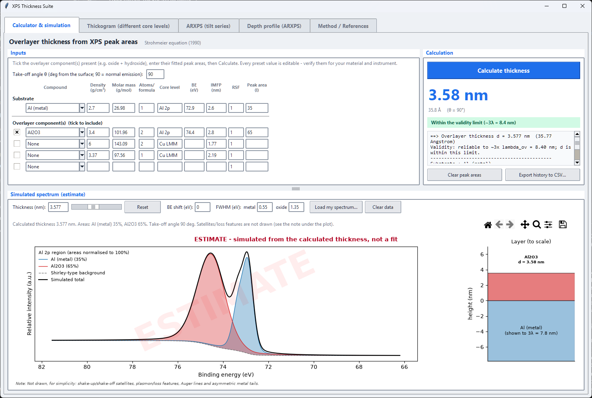
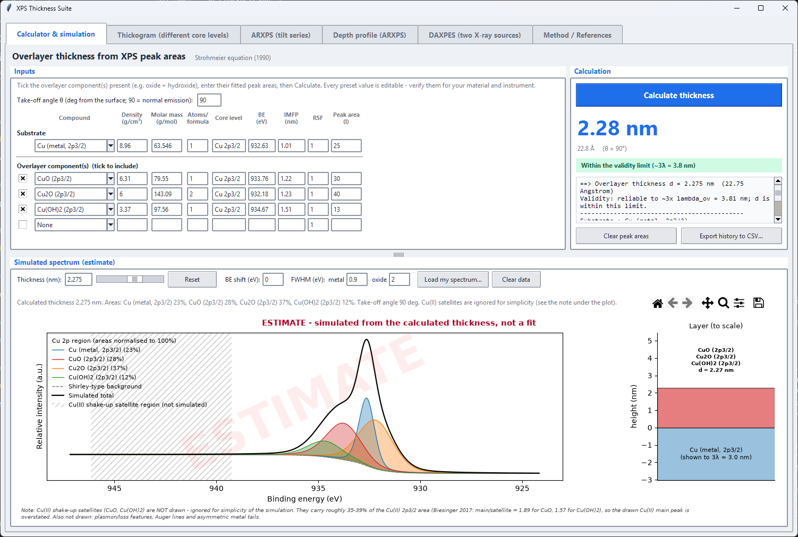
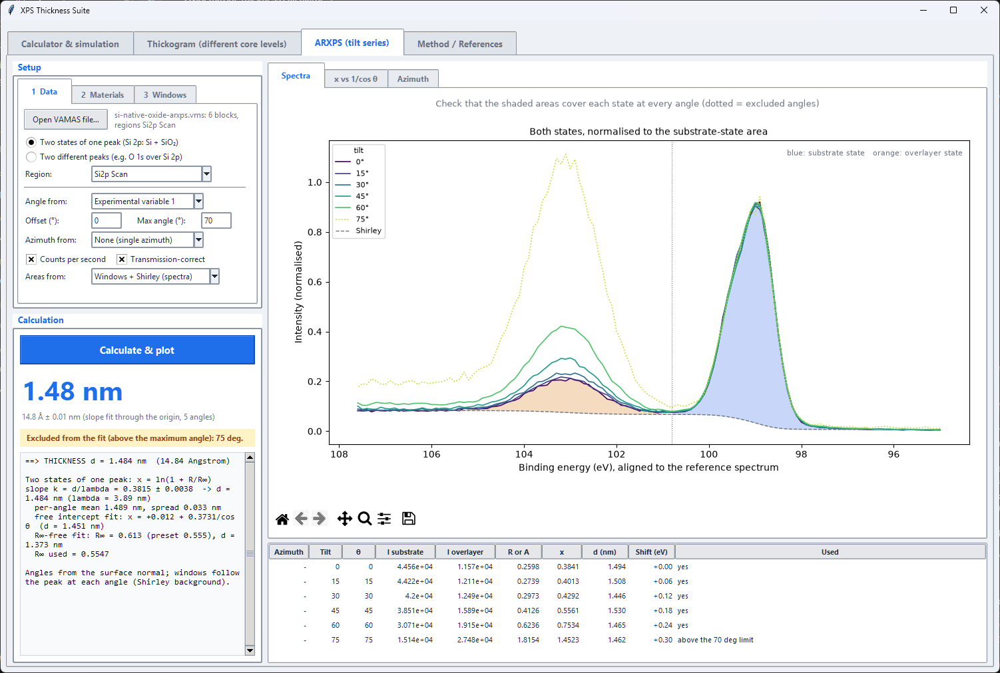
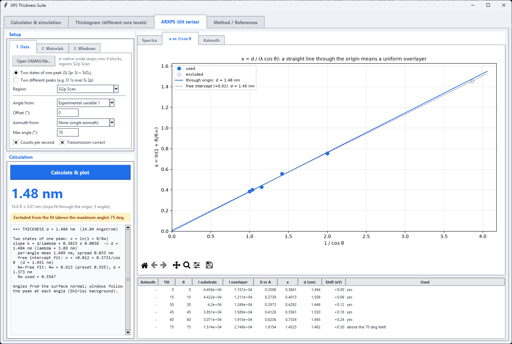
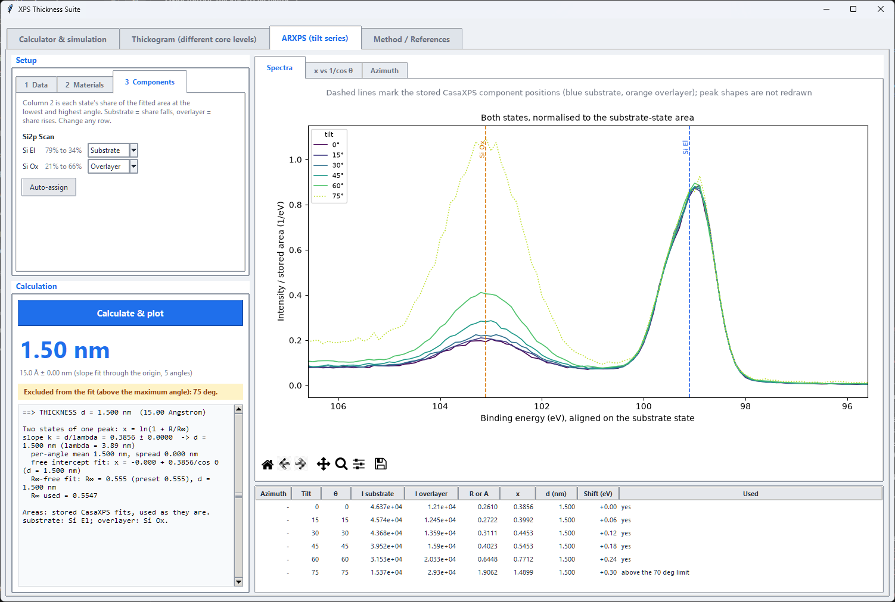
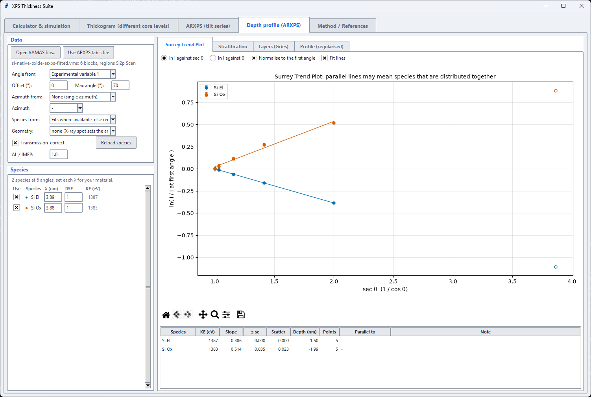

# User guide

The XPS Thickness Suite estimates the thickness of thin overlayers (oxides, hydroxides, nitrides, passivation layers,
contamination films) from XPS peak areas. It has one window with a tab for each method.

Contents: [Starting the app](#starting-the-app), [The Calculator tab](#the-calculator-tab),
[The Thickogram tab](#the-thickogram-tab), [The ARXPS tab](#the-arxps-tab),
[The Depth profile tab](#the-depth-profile-tab), [The DAXPES tab](#the-daxpes-tab),
[Which tab should I use?](#which-tab-should-i-use), [Troubleshooting](#troubleshooting).

## Starting the app

You need Python 3 with Tkinter, which comes with the standard Windows installer. The calculator itself needs nothing
else. The simulated spectrum, the Thickogram and ARXPS tabs and the typeset equations in this documentation also need
numpy and matplotlib:

```
pip install numpy matplotlib
python app.py
```

The window sizes itself to your screen. On a short screen, such as a 1366 by 768 laptop, it switches to a compact
layout with smaller fonts and tighter rows. Hover over most buttons and boxes for a short tip.

## The Calculator tab



Use this tab when the overlayer and the substrate are two chemical states of the **same core level**, for example
metallic Al and aluminium oxide in the Al 2p spectrum. It applies the Strohmeier equation described in
[Methods](methods.md#strohmeier-equation-calculator-tab).

### Inputs

1. Choose the **substrate** from the first drop-down, for example Al (metal). The row fills in with reference values.
2. For each **overlayer component** present, pick it from the drop-down and tick its box. Tick several for a mixed
   layer such as oxide plus hydroxide. Untick or choose None to leave a component out.
3. Type the fitted **peak areas** (the last column). Enter the substrate area on the substrate row and the area of each
   overlayer component on its own row. Any consistent unit works, because only ratios matter.
4. Set the **take-off angle** $\theta$ measured **from the surface**: 90 means normal emission.

The other columns are pre-filled but editable:

| Column | Meaning |
|---|---|
| Density, Molar mass | Used to work out the volume density of the metal atoms in each phase |
| Atoms/formula | Metal atoms per formula unit, for example 2 for Al2O3 |
| Core level, BE | The peak the row refers to, and its binding energy (also used to position the simulated spectrum) |
| IMFP | Inelastic mean free path of the photoelectrons in that phase, in nm |
| RSF | Relative sensitivity factor; leave at 1 when both areas come from the same core level |
| Peak area | The fitted area of the peak |

Every preset value is a default to check, not an authority: the density of a thin film can differ from the bulk, and
the IMFP depends on your X-ray source. Details of where each value comes from are in
[Presets and data](presets.md#presets-and-data). In particular, **use the Cu (LMM) presets with areas from the Cu LMM
Auger fit, and the Cu (2p3/2) presets with areas from the Cu 2p3/2 fit**; mixing the sets changes the answer by about
30 percent.

### Calculation

Press the blue **Calculate thickness** button (or press Enter in any input box). The right-hand card shows

- the **thickness** in nm, with the same value in angstrom;
- a **badge**: green when the thickness is within the method's validity limit of about three IMFPs, amber when it is
  close, red when it exceeds the limit and the result may be unreliable;
- the details: the weighted density and IMFP of the overlayer, and the density ratio.

**Clear peak areas** empties the area boxes and keeps the presets. **Export history to CSV** saves every
calculation from the session.

### Simulated spectrum

Below the inputs, the app draws what that thickness looks like in the core-level spectrum, next to a to-scale picture
of the layer. This is an **estimate** for visual comparison, not a fit, and the figure says so.

- **Thickness** box and slider: try other thicknesses (the what-if values); **Reset** returns to the calculated one.
- **BE shift**: move the simulated peaks to match your charge correction.
- **FWHM**: the width of the metal and of the oxide peaks; set them to match your instrument.
- **Load my spectrum** overlays a two-column text or CSV file (binding energy, intensity). It is scaled to the
  height of the simulation, so it compares shapes and positions, not absolute counts.
- The toolbar zooms, pans and saves the figure as an image. Drag the divider above the plot to give it more room.

The note under the plot states what is **not** drawn: satellites, plasmon and loss features, Auger lines and
asymmetric metal tails. For Cu 2p3/2 with CuO or Cu(OH)2 the shake-up satellite region is shaded and marked "not
simulated". Auger presets, such as Cu LMM, are not simulated at all.



### Worked example: Al2O3 on Al

Choose Al (metal) as the substrate and Al2O3 as the overlayer. With Al 2p areas of 35 for the metal and 65 for the
oxide at a take-off angle of 90 degrees, the calculator gives a thickness of **3.58 nm (35.8 angstrom)**. This is
the same number as Biesinger's Al oxide spreadsheet, which uses Strohmeier's values.

### Worked example: oxide and hydroxide on Cu

Choose Cu (metal, LMM) and tick Cu2O (LMM) and Cu(OH)2 (LMM). A Cu LMM fit of 25 percent metal, 63 percent Cu2O and
13 percent Cu(OH)2 at 90 degrees gives **3.22 nm**, matching the roughly 3.2 nm that Biesinger reports for this
spectrum [5].

## The Thickogram tab


Use this tab when the overlayer and the substrate give **different peaks**, for example a Fe 2p overlayer on a Si 2p
substrate, or carbon on silica. It applies Cumpson's Thickogram and, if the sample is a fibre or a particle, a
Topofactor. The method is in [Methods](methods.md#thickogram-thickogram-tab).

### Inputs

| Field | What to enter |
|---|---|
| Overlayer / substrate binding energy | Binding energy of each peak in eV, for example 707 for Fe 2p and 100 for Si 2p |
| Overlayer / substrate peak area | The fitted peak areas as measured in your software |
| Overlayer / substrate RSF | The sensitivity factor of each peak (see below) |
| Lambda L | Attenuation length of the **overlayer's** photoelectrons in the overlayer, in nm |
| Theta | Take-off angle from the surface **normal**: 0 means normal emission |
| X-ray source energy | 1486.6 eV for Al K-alpha, 1253.6 eV for Mg K-alpha; use the buttons |

Things to watch:

- **The angle convention differs from the Calculator tab.** Here 0 degrees is normal emission and the angle is
  measured from the surface normal; on the Calculator tab 90 degrees is normal emission. The tab shows the
  equivalent surface angle next to the box.
- The **RSFs** are typed in. If you want to follow Cumpson and Shard exactly, enter each sensitivity factor already
  multiplied by the atomic fraction of the element in the pure material.
- The optional **preset** drop-downs fill the binding energy (and lambda for the overlayer) from the Calculator's
  reference table. Presets give an IMFP, which is about 10 percent longer than an attenuation length.
- **Load example** fills demonstration numbers. **Copy from Calculator** takes the angle (converted), binding energies
  and lambda from the Calculator tab, but not peak areas or RSFs.

Press **Calculate and plot**. The big number is the thickness; the nomogram marks the solution with a red line from the
intensity ratio on the left scale through the energy ratio on the right-hand scales, and the thickness is where it
crosses the green curve.

### Sample shape and Topofactors

By default the sample is treated as flat. For a **fibre or a particle** choose its shape under *Sample shape*; the tab
then applies a Topofactor [4], the factor $\mathrm{TF} = T/t$ that converts the apparent planar thickness $t$ into the true
conformal thickness $T$. The big readout shows the corrected value, with the planar value and the factor beside it,
and the nomogram is annotated with all three.

| Shape | Use it for | Typical factor |
|---|---|---|
| Cylinder (fibre) | A fibre lying with its axis perpendicular to the plane of source, sample and analyser | about 0.79 |
| Sphere, X-rays reach all of it | A particle with the X-ray source collinear with the analyser | about 0.67 |
| Sphere, X-ray shadowed | A particle with the source at 45 to 65 degrees to the analyser | about 0.71 |

*Topofactor* chooses between **Eq. (6)**, which depends on the thickness and on the energy ratio, and the **constant
average** values in the table, which are good to about 10 percent.

Before relying on a Topofactor, check that:

- the sample's mean normal faces the analyser, with the take-off angle set to 0 (the tab warns otherwise);
- the fibres or particles are **much larger than the attenuation length**. Topofactors do **not** apply to nanoparticles
  or nanofibres;
- the overlayer is uniform and conformal, and the two peaks are cleanly separated.

### Worked example: a coating on a fibre

Take carbon (C 1s at 285 eV) as the overlayer on a silica fibre (Si 2p at 99.5 eV), with Al K-alpha X-rays, peak areas of
800 and 3000, sensitivity factors of 1.0 and 3.0, an attenuation length of 3.0 nm and normal emission. The planar
Thickogram gives **1.85 nm**. Choosing Cylinder (fibre) with Eq. (6) applies a Topofactor of **0.736** and gives a
corrected thickness of **1.36 nm**.

## The ARXPS tab



Use this tab when you have measured the same spot at **several emission angles** (a tilt series) and want the
overlayer thickness from the slope of a line instead of from a single ratio. It reads VAMAS files, finds and aligns the
peaks, subtracts a Shirley background, integrates the areas and fits the thickness. The method is in
[Methods](methods.md#angle-resolved-xps-arxps-tab).

### Workflow

The setup has three pages. Work through them from left to right and press **Calculate and plot**.

**1 Data.** Press *Open VAMAS file* and choose a `.vms` file. Then choose:

| Field | What to enter |
|---|---|
| Mode | *Two states of one peak* when the overlayer and substrate are two chemical states in one region, for example Si and SiO2 in Si 2p. *Two different peaks* when they are separate regions, for example O 1s over Si 2p |
| Region | The block (region) to analyse; in the two-peak mode one region for each peak |
| Angle from | Where the tilt comes from. The K-Alpha stores the stage tilt in experimental variable 1, the default |
| Offset | Added to the tilt to give the emission angle from the surface normal (0 for the K-Alpha) |
| Azimuth from | Optional: the field that holds the sample azimuth. If the file has several azimuths each is fitted separately |
| Max angle | Angles above this are drawn but left out of the fit (default 70 degrees) |
| Counts per second, Transmission-correct | Normalise the intensities; they cancel for two states of one peak but matter for two different peaks |
| Areas from | *Windows + Shirley* integrates the spectra. *Fitted components* uses a peak fit that CasaXPS stored in the file; it is chosen automatically when the region has one |

**2 Materials.** Optionally choose the substrate and overlayer presets, the same ones as on the Calculator tab: they fill
the binding energies, lambda for the overlayer and, for two states of one peak, the ratio $R_\infty$ of the two layers
when infinitely thick. Everything can be edited. For two different peaks enter the sensitivity factors, the binding
energies and lambda yourself; the photon energy is read from the file.

**3 Windows.** Press *Auto-detect windows*. For two states of one peak this sets the envelope that holds both
peaks and the energy at which it is split; for two peaks it sets a window round each. The detection uses how the spectrum
changes with angle, so it also works when the oxide peak is the taller one. **Always check the result on the Spectra
plot**: the blue and orange areas should cover each state at every angle.

**3 Components.** When the areas come from a CasaXPS fit this page replaces the windows. It lists the fitted states
(components that share an INDEX, such as the two halves of a doublet, count as one) with each state's share of the fitted
area at the lowest and highest angle, and a selector: *Substrate*, *Overlayer* or *Ignore*. The tab fills it in by
the trend, a falling share meaning substrate and a rising share overlayer; change any row, or press *Auto-assign* to
start again.

### Reading the results

- The big number is the thickness from the slope of the line through the origin, with the standard error of the fit.
- **Spectra** shows every angle, aligned and normalised, with the Shirley background and the two integrated areas. Dotted
  lines are angles left out of the fit.
- **x vs 1/cos theta** shows the per-angle reduced thickness $x$ against $1/\cos\theta$. For a uniform overlayer the points
  lie on a straight line through the origin; the dashed line is a free-intercept fit and its offset is the check.
- **Azimuth** appears as a polar plot when the file has more than one azimuth. The mean thickness is shown, with the
  spread between azimuths.
- The table lists, for each angle, the two areas, the ratio, $x$, the thickness from that angle alone and the energy
  shift that was removed.
- An amber badge names any problem: an intercept away from the origin, angles left out, fewer than three angles, a
  peak split that cannot separate overlapping states, or a thickness beyond three attenuation lengths.



### Worked example: a synthetic Si 2p tilt series

The file `docs/sample/si-native-oxide-arxps.vms` is a **synthetic** series (not a measurement) for a 1.5 nm layer of SiO2 on
silicon, with the peaks drifting by 0.3 eV with tilt, Poisson noise and tilts of 0 to 75 degrees. Open it, choose the
region Si2p Scan, the presets *Si (metal/elemental)* and *SiO2* (lambda 3.89 nm, $R_\infty$ = 0.555) and press
*Auto-detect windows*: the envelope is 96.5 to 106.1 eV, split at 100.8 eV. The result is **1.48 nm**, within 0.02 nm of
the value that was put in. The 75 degree point is left out by the 70 degree limit, and the free-intercept fit passes
through the origin to within its error.

### Using a peak fit from CasaXPS



If you have fitted the region in CasaXPS and saved the file as VAMAS, open that file. The tab finds the fit, sets
*Areas from* to *Fitted components* and fills the list on the Components page. The areas are taken exactly as CasaXPS
stored them, so nothing is re-integrated and no window or background has to be chosen. This is the way to analyse
states that overlap too much for a window split, such as the oxide and substrate components of Ga 3d on GaAs.

- For **two states of one peak** pick the region; the substrate and overlayer states are sums of the states you assign.
- For **two different peaks** choose the region holding the substrate fit and the region holding the overlayer fit
  (each must be fitted); the sensitivity factors and binding energies are filled in from the fit and can be edited.
  Keep *Transmission-correct* ticked, because the stored areas are raw counts.
- If a block holds several fitted regions, such as Ga 3d and As 3d in one scan, a selector on the Components page
  chooses which to use.
- On the Spectra page the measured spectra are drawn with a dashed line at each fitted component position; the peak
  shapes are not redrawn.

### Worked example: a synthetic file with a stored fit

The file `docs/sample/si-native-oxide-arxps-fitted.vms` holds the same synthetic series as above with a CasaXPS-style fit
stored in each block (two doublets, Si El and Si Ox). Open it, choose the region Si2p Scan and the presets *Si (metal/elemental)*
and *SiO2*: the tab selects the fitted components, makes Si El the substrate and Si Ox the overlayer, and gives
**1.50 nm** after *Calculate and plot*, with no windows to set.

### Tips

- Use a series with at least three angles spanning a good range of $1/\cos\theta$. Angles between about 0 and 60 degrees
  are the most reliable.
- Two states less than about 2 eV apart (for example the oxide and the substrate component of Ga 3d in GaAs) overlap
  too much for a window split. The tab warns, and the thickness is then only a rough estimate; fit the peaks in
  CasaXPS and use the fitted components instead.
- The thickness uses the attenuation length you give, so its accuracy is limited by that number and by $R_\infty$. The
  *R-infinity-free* line in the details shows what the data alone prefer.
- Real data often show an intercept above zero: contamination, roughness and elastic scattering all bend the line. The
  badge says when it is more than the scatter allows.
- **Coverage f** (two states of one peak): leave it at 1 for a complete layer. If the overlayer is patchy (islands, a
  partly covered wafer) enter the fraction of the surface it covers, or type `fit` to let the angles choose it. A complete layer
  assumed for a patchy one gives a thickness that is too small. The details box shows the fitted $f$ and warns when the angles
  cannot determine it; it does not apply to the two-peaks mode.

## The Depth profile tab



Use this tab when you want to know where several species sit in depth, not just the thickness of one overlayer. It reads the
same VAMAS tilt series as the ARXPS tab. The method is in [Methods](methods.md#depth-profiles-depth-profile-tab).

1. Press *Open VAMAS file* or *Use ARXPS tab's file* (which also takes the file you already loaded there).
2. Check *Angle from*, *Offset* and *Max angle* as on the ARXPS tab.
3. Choose *Species from*: *Fitted states* uses every chemical state of the CasaXPS fits in the file (chosen automatically if
   there are any); *Whole regions* integrates each region with a Shirley background and works with any file.
4. In the Species list untick anything you do not want and set each attenuation length *lambda* for your material. The
   starting values are only a guide.

### Surrey Trend Plot

Each species is drawn as ln(intensity) against sec theta (or against theta), with error bars from counting statistics when
they are known and a straight-line fit. Species whose lines run parallel, and whose kinetic energies are similar, may be
distributed together. The table gives each line's slope, its error, the scatter of the points, an apparent depth
(minus lambda times the slope), and which other species run parallel. Use it as a first look before choosing a model: it
tells you how many distinct depth distributions the data hold and how noisy they are.

### Stratification

Choose two angles (normal emission and one oblique angle, about 67.5 degrees, are the usual pair; the default is the smallest
angle and the one nearest 67.5 degrees within the maximum angle) and each species is placed at its **average depth**, with
its **relative amount**, drawn as bars: position is depth and width is amount. The table adds the error of the depth from the
counting statistics, the intensity ratio, and a curvature statistic that warns when a species looks to sit in more than one
layer. *Use every angle* fits all the angles instead.

Notes: a finite overlayer is not a thin buried layer, so its intensity rises with angle and the tab reports it at the surface
with a note; a substrate that goes on forever is reported at its information depth. In the synthetic fitted sample the
silicon substrate state is placed **1.50 nm** deep, which is the thickness of the oxide above it. If every species falls with
angle faster than a thin layer can explain, set *Geometry* to *multiply by cos θ (analyser sets it)* on the Data card if the analyser (not the X-ray beam) defines the analysed area.

### Relative depth

A quick **layer-ordering** plot. Each species is a dot, placed by how much it gains between a low and a high angle (the two
angles chosen on the Stratification page): the higher the dot, the nearer the surface. Use it first, to see whether the order of
the layers is what you expect, before trusting a depth from Stratification or Layers. There is no depth scale here. The
*Formula* box offers the definition from the literature (the logarithm of each species' atomic % at the high angle divided by
that at the low angle, undefined for shares of about 1 % or less) and a unit-free form, the logarithm of the intensity ratio,
which orders the species the same way as Stratification. The table adds the uncertainty, the atomic percentages and the
curvature statistic; the note warns about a species that may sit in two layers (it is averaged) and about species whose
kinetic energies differ so much that their attenuation lengths do too.

### Layers (Gries)

Put each species in a layer, from 1 at the top to *Sub* for the substrate, and the
tab draws the predicted intensity against angle over the measured points, with a stack diagram beside it. Drag a thickness
slider, or type a value, and the curves move: adjust the top layer first, then the next, until they follow the points. Only the
shape of each peak against angle is used, so no sensitivity factors are needed. *Fit thicknesses* does the adjustment by least
squares and *Scan ranges* shows, for each layer, the range of thickness that fits within the noise: a wide range for a deep
layer means the data cannot say. The note under the table gives chi-squared per point; a value far above 1 means the model
(uniform layers, the chosen geometry) does not describe the data.

Each species has to belong to one layer, so use *Fitted states* for regions that hold several states. Species can come from
fits where they exist and whole regions elsewhere (the default).

*Auto-assign* makes a first guess. When there are fitted states the substrate is the one whose share of the fitted area falls
most with angle (a buried state falls, an overlayer rises); without them it is the species with the greatest average depth,
which is crude because a substrate that goes on forever has no single depth. Whole-region species that mix several depths, such
as Si 2s (substrate plus oxide), start unticked with a note, because they do not belong in a stack: use their fitted states. The
rest are ranked by average depth, the shallowest in layer 1, except that a plain C 1s region is assumed to be adventitious carbon and starts in layer 1 (the depth ranking cannot see a patchy carbon layer). Always check the assignment.

### Profile (regularised)

For species that are spread through the depth rather than in layers, *Calculate profile* draws a smooth concentration-depth
profile for each one, with the intensities it predicts (lines) over the measured points beside it. Set the maximum depth and
the number of depth points; *Auto alpha* chooses the smoothing from the noise, or untick it and give log10 of alpha. The
**prior knowledge** boxes are what sharpen the result: say that a bulk species is *constant below z* (the metal under an oxide)
or that a surface species is *zero below z*, and tick *Non-negative*. *Atomic fraction* shows the species as shares of 1,
and the shaded bands are the uncertainty from counting noise (not the smoothing bias). With only a few angles the depth
resolution is limited to roughly lambda times cos theta at the largest angle, which the note under the buttons states; a
negative concentration in a free profile means an assumption, such as an attenuation length, needs another look.

The *Method* box switches to the **3-point (ARCtick)** method: three concentrations at three knots whose spacing the data can
resolve, fitted by least squares with no smoothing parameter (so Auto alpha, Non-negative and the depth points do nothing). It
gives a much blunter profile than the Tikhonov one, which is the point: it shows only what five or so angles can support.

Starting attenuation lengths are inelastic mean free paths; set *AL / IMFP* to about 0.8 to approximate attenuation lengths
and press *Reload species*. Keep to angles below about 70 degrees.

### Profile (Murdoch)

A depth profile of the **apparent atomic concentrations** (peak area over sensitivity factor, shares summing to 100 at%),
after Murdoch and McCulloch [20]. Because it uses shares, a factor common to all peaks cancels, so it is less sensitive to the
tilt geometry than the intensity-based panels. Tick the peaks to use in the **Use** column (a region that mixes several depths, such as Si 2s, starts unticked; give each peak its sensitivity factor), or load a CSV
whose first column is the angle and whose other columns are the at% of each named peak.

For each peak set the attenuation length (*Murdoch EAL* fills them from the kinetic energy, semi-quantitatively), its **Order** in the
initial guess stack from the top (1) down to the substrate (last), and a guessed **thickness** for each layer. Press *Fit*:
the left plot shows the profile (solid) and the initial guess (dashed); the right plots compare measured (points) and
calculated apparent concentrations against angle and show the S-curve. *S-curve* scans log10 alpha and sets the largest
alpha whose chi-squared is within 25 percent of the minimum; *Initial-guess ensemble* shades the spread of fits from guesses
whose thicknesses vary by 50 percent, which is how much the answer depends on what you assumed. The table lists each peak's
position and width at half maximum; a note says when the minimiser did not converge, or when there are far more slabs than
data (the profile is then set by the regularisation and the guess). Treat narrow features as unresolved.

### ARXPS MEMS (Rossi)

A maximum-entropy depth profile of the apparent concentrations of three or more species, after Scorciapino, Navarra, Elsener and Rossi
[27]. Tick the species on the Depth profile tab and set their λ and sensitivity factors as for the other pages; this page adds a
**material per species** (a preset, or a formula and density; *Guess materials* sets them from the names, so check them) and a **start
model**: layers with a thickness and a composition in % (the last row is the bulk; the default is one species per layer in the order
of the Stratification depths, and *Reset start model* rebuilds it). The start model is the entropy prior: the profile moves away
from it only as far as the data demand, so make it as good as you can (the paper's whole protocol exists to find a good one).
*Run MEM* runs the α schedule (default 100, 30, 10, 3, 1, 0.3, 0.1; it stops at the first α that fits within σ if *Stop at χ²/N ≤ 1* is
ticked) and, with *Iterate IMFP*, recomputes the attenuation lengths from the composition of each cycle's profile. The plots show the
profile with the start model dashed, the measured and calculated apparent concentrations, and the relative depth plot; the table lists
each species' area, peak depth, the attenuation length it sees at the surface and deep down, and its relative depth, and the note
the χ² per point of each cycle and the interfaces found. *Start-model ensemble* repeats the run from 8 starts with the thicknesses
varied by ±30 % and shades the spread. *Auto start* does the paper's hand-made "simulator" step for you: it searches the layer
thicknesses and compositions (for the number of layers set in the start-model box, including the bulk; about a minute) that
fit the apparent concentrations best and writes them into the start model. *Run protocol* is the paper's cycle: pseudo-Gaussian
components whose depths may move 0.6 nm, then the free-layer fit, repeated until the profile changes by less than 1 %; the note shows
each cycle and the *minimum depth*, the depth below which these data cannot tell the profile from bulk. The runs freeze the window
until they finish. G-1 attenuation lengths are for 200-2000 eV, and NIST cautions that they can be off by up to
50 % for some materials: choose *own λ per species* to use the lengths on the species table instead. The paper tested the method on
synthetic structures only; treat a profile from real data as one consistent with the measurements, not as the unique answer.

## The DAXPES tab

Use this when a film may not cover the whole analysed area (islands, patterned oxide, a wafer with a partly grown layer) and
the instrument has two X-ray sources, a soft one (Al Kα) and a hard one (Ag Lα or Ga Kα). It measures **one core level with each
source** and gives the film **thickness**, which does not depend on the coverage, and the **coverage** itself [24].

1. Open four spectra with the buttons on the Data card: the film with the soft source, the film with the hard source, and a
   thick reference of the same material with each source. A file can hold both the film and the reference regions: open it for
   both slots and pick the region in the box next to the button. The photon energies are read from the files.
2. Press *Auto window* (or type the window) and, if you like, tick *Follow small energy shifts*. One binding-energy window is used
   for all four spectra, with a Shirley background.
3. Set the attenuation lengths, soft and hard (the hard one must be longer). *Fill λ* gives a starting estimate for TiO2,
   Ga2O3, SnO2, SiO2 or Si, from Seah's universal curve (the default) or from TPP-2M times the AL/IMFP factor; for any other
   material type the two lengths in.
4. Press *Calculate & plot*. The readout is the DAXPES thickness; the badge and the details give the coverage, the thickness a
   single source alone would report, how far the thickness and coverage move if the attenuation lengths are 10 % off (the
   ratio of the two lengths matters most), and warnings. The left plot shows each source against thickness with your measured values;
   the right one shows the ratio of the two sources, whose value fixes the thickness whatever the coverage.

You can type any area (the boxes at the bottom of the card override the files), and if you have no reference spectra you can
type the ratio of the thick-reference areas, hard over soft: you then get the thickness but no coverage. The sample pair
`docs/sample/daxpes-tio2-al-ka.vms` and `daxpes-tio2-ag-la.vms` (synthetic: 3 nm covering 60 %, with a reference region in each
file) gives about 3.0 nm and 60 % with λ = 1.87 and 3.77 nm. Both sources must analyse the **same area** of the sample.

**Background method (no reference sample).** Set *Method* to *Inelastic background B1* and open only the two film spectra,
each recorded over a wide range: from a flat level below the peak to at least 30 eV (the ΔE on the Method page) above it. The tab
fits the Tougaard background parameter B1 of each (the Method page offers the cross-section parameters C and D: oxides or silicon,
or type them) and solves Murdoch's Eqs. 7 and 8, so the thickness needs no reference and no knowledge of either source's flux or
cross-section; you can also type B1 values from other software. The details give d*, the thickness from Eq. 8, the simple
2d*cosθ reading and the 3λ cap; the spectra page shows the spectrum, the fitted background and the primary spectrum with the
point where it is forced to zero. The coverage appears if you also give the film and thick-reference peak areas (open the
reference spectra too, or type the areas). Only elemental information comes out, and the paper found it underestimates films
thinner than about 3 nm. *Fit B1 over ΔE-15 to ΔE+15 eV* switches to a least-squares B1 over 15-45 eV above the peak, about
three times less noisy than the single point of the paper. The sample pair `docs/sample/daxpes-bg-al-ka.vms` and `daxpes-bg-ag-la.vms` (synthetic: 6 nm covering
60 %) gives B1 about 1190 and 790 eV², and a thickness of 5.6 ± 0.6 nm from Eq. 8 (6.2 nm from the exact B1 values).

**Both methods.** If the film spectra are wide enough for the background and you also have the thick references, set *Method* to
*Both methods, with a consistency check*. The tab runs the peak-area and the background method on the same data, compares the
two thicknesses like for like and warns when they disagree, and fits the thickness and the ratio of the two attenuation lengths
from both measurements together, with a prior (width on the Method page, 10 % by default) on the ratio you entered. The details
show the ratio the data prefer next to yours, which is the check on the Seah or TPP-2M lengths; the *Consistency* page plots each
measurement as a curve in the thickness-length-ratio plane, where they cross; the *Background (B1)* page shows the B1 fits; and a
table lists B1 and the thickness for other ΔE, the band fit and the silicon cross-section, so you see how much rests on those
choices. On the synthetic background sample with Seah's lengths (ratio 2.18) the peak areas alone read 6.5 nm for a true 6.0 nm, and
the joint fit gives 6.1 ± 0.4 nm with a ratio of 2.07 ± 0.08 (true 2.02).

## Which tab should I use?

| Your situation | Use |
|---|---|
| Oxide on its own metal, one core level, flat sample | Calculator tab |
| Overlayer and substrate are different elements or different peaks, flat sample | Thickogram tab, shape Flat |
| Coating on a micro-scale fibre or particle | Thickogram tab with a Topofactor |
| A tilt series (several emission angles) in a VAMAS file | ARXPS tab |
| Where several species sit in depth, from a tilt series | Depth profile tab |
| A film that may cover only part of the area, on an instrument with a soft and a hard X-ray source | DAXPES tab |
| Nanoparticles or nanofibres | Neither: the Topofactor model is not valid at this scale |

For equal kinetic energies the Thickogram reduces exactly to the Strohmeier equation, so the two tabs agree where
their assumptions overlap.

## Troubleshooting

- **The Thickogram tab or the spectrum pane says to install numpy and matplotlib.** Run `pip install numpy matplotlib`
  and restart the app. The Calculator's thickness calculation still works without them.
- **The equations in this documentation appear as plain text.** The same packages are needed for typeset equations.
- **A badge turns amber or red.** Read it: it names the problem, for example a thickness beyond the validity limit, a
  binding-energy ratio outside the nomogram scales, or a Topofactor applied off normal emission.
- **Auto-detect windows fails or the shaded areas look wrong on the ARXPS tab.** Check that the presets (or binding
  energies) are close to your peaks and that the lowest angle is first; set the envelope and split by hand on the
  Windows page if the two states are not resolved.
- **The ARXPS thickness changes a lot when I move the split.** The two states overlap; see the tips under the ARXPS tab.
- **The Components list is empty or says there is no fit.** The file has to be saved from CasaXPS with the fit in
  place; a file that CasaXPS only opened, or the original instrument file, carries no fit. Switch *Areas from* to
  *Windows + Shirley* to integrate the spectra instead.
- **A state is assigned to the wrong side.** The guess uses how the share of each state changes with angle, which
  fails for a state that hardly changes; set it by hand in the list.
- **A preset says it has no binding energy.** Auger presets, such as Cu LMM, carry no binding energy; type the
  binding energy of your own peak.
- **The numbers look about 30 percent off for copper.** Check that you did not mix the LMM and 2p3/2 presets.
